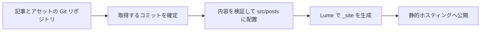

# 記事とアセットを別の Git リポジトリで管理する案

作成日: 2026-11-20。実装更新: 2026-11-23。
記事の同期・検証・配置とローカルの記事作成を実装済み。現在の実行手順は [README](../README.md) を参照。
記事とアセットを別リポジトリで管理し、ビルド時に取得する方針を反映する。 記事の Git
ホスティング先と URL は未定で、非公開リポジトリを予定。サイトは既存の
[Vercel プロジェクト `elendia-network/blog-elendia-net`](https://vercel.com/elendia-network/blog-elendia-net) を使い、
設定変更はユーザーがダッシュボードで行う。microCMS は記事の Git 移行が終わるまで併用し、その後削除する。

## Git の取得と Lume の生成を分ける

サイト側のリポジトリは、レイアウト・スタイル・生成処理・CI を持つ。
記事側のリポジトリは、本文・メタデータ・画像などを持つ。 ビルド前に記事を取得してローカルに配置し、Lume は通常の
Markdown として処理する。 サイト側のコードに GitHub などの固有 API を組み込まず、Git の URL と取得対象の ref
を設定で渡す案を推奨する。 Git は HTTPS / SSH などの接続方式に対応するため、接続先と認証方法を分けて設定できる。
[Git の接続仕様](https://git-scm.com/docs/git-clone#_git_urls)



| 取得方式                            | このブログでの判断                                                                                   |
| ----------------------------------- | ---------------------------------------------------------------------------------------------------- |
| ビルド前に clone / fetch            | 推奨。記事だけの更新でビルドでき、取得したコミットを記録できる                                       |
| Git submodule                       | サイト側で記事のコミットを固定してレビューしたい運用なら候補。通常の更新では記録済みのコミットを使う |
| ホスティング固有の API / アーカイブ | 接続先の仕様が決まった後の選択肢。初期設計では必要としない                                           |

submodule のコミット固定と更新動作は [Git の説明](https://git-scm.com/docs/git-submodule) を参照。 clone
方式でも固定コミットを指定可能にし、記事の最新版を取得する運用と再現用のビルドを両立させる。

## 記事ごとに本文とアセットをまとめる

記事リポジトリの構成案:

```text
posts/
  example-post/
    index.md
    assets/
      cover.webp
      diagram.svg
```

`index.md` の例:

```markdown
---
title: 記事タイトル
date: 2026-11-20T10:00:00+09:00
url: /posts/example-post/
tags:
  - TypeScript
draft: false
---

本文。


```

この構成なら、エディターで本文と画像を一緒に扱える。 `posts/example-post/` をサイト側の `src/posts/example-post/`
に配置し、 画像を `/posts/example-post/assets/cover.webp` として配信する。 記事の公開 URL
はディレクトリ名と一致させ、独自 URL を許可する場合はアセットの配置も合わせる。

`date` は必須にし、公開日時をタイムゾーン付きで記録する。 Git の checkout
日時・ファイル作成日時・コミット日時から公開日を推定しない。 Lume は front matter で `date`、`url`、`tags`、`draft`
を指定できる。 [ページデータの仕様](https://lume.land/docs/creating-pages/page-data/)

サイト固有の `layout`、`type: post`、テンプレートの処理順は、 サイト側の `src/posts/_data.json`
に残す。記事側にレイアウトの実装を複製しない。 当面は既存の Vento → Markdown の順を維持し、埋め込みの互換性を確認する。
front matter の日時へ移行できれば、日付付きファイル名と Extract date プラグインへの依存を外せる。 現在の
`src/_archetypes/new-post.ts` も見直し、記事作成コマンドは編集用の記事リポジトリへ `posts/{slug}/index.md`
と日時を作成するものに変える。ビルド用に配置した記事を直接編集しない。

## 取得・検証・配置の後にビルドする

実装済みのコマンドと設定の役割は次のとおり。

| コマンド / 設定      | 役割                                                          |
| -------------------- | ------------------------------------------------------------- |
| `content:sync`       | Git またはローカルの記事を読み、検証してビルド用の場所に配置  |
| `build`              | `content:sync` が成功した後に `lume build` を実行             |
| `serve`              | 記事を配置してから開発サーバーを起動                          |
| `CONTENT_REPOSITORY` | 記事リポジトリの接続先。認証情報を URL に含めない             |
| `CONTENT_REF`        | 通常取得するブランチ・タグ、または取得可能なコミット ID       |
| `CONTENT_DIR`        | ローカルで編集中の記事ディレクトリ。指定時は Git の取得を省略 |

非公開リポジトリの HTTPS 認証には、`CONTENT_GIT_USERNAME` と `CONTENT_GIT_TOKEN` を使う。
トークンは記事リポジトリだけを読み取れるものとし、Vercel の環境変数に設定する。
ユーザー名の要件は Git ホスト決定後に確認する。`CONTENT_REF` は明示的な指定を必須とし、公開用ブランチを推測しない。

1. Git を使う場合は、`src/` の外にある `_content/` へ取得する。 指定 ref をコミット ID
   に解決し、同じビルドの途中で取得対象を変えない。
   任意のコミットを取得できない接続先では、必要な履歴や固定タグを取得する方式を選ぶ。
2. `title`・`date`・タグの型、URL の重複、相対パスで参照するアセットの存在を検証する。 公開ビルドでは `draft: true`
   の記事ディレクトリ全体を配置対象から外す。
3. `src/posts/` に検証済みの本文とアセットを配置する。 既存の `_data.json`
   と手元の記事を一括削除せず、生成処理が管理するファイルだけを置き換える。
   前回から削除された記事・アセットも、管理対象の記録に基づいて取り除く。
4. Lume で生成する。画像・PDF などは合意した拡張子を `site.copy` / `site.add` で明示する。 現在の `.jpg`・`.png`
   だけの設定では、例にある WebP・SVG は出力対象にならない。
5. サイト側と記事側のコミット ID をビルド記録に残す。 取得・検証に失敗した場合は公開せず、直前の公開版を維持する。

アセットの登録と出力パスは [Lume のファイル登録仕様](https://lume.land/docs/configuration/add-files/) を参照。
下書きページの除外だけでは画像の除外まで保証できないので、公開用の配置処理でまとめて制御する。 `CONTENT_DIR`
を使う開発では、初期版は再同期コマンドで反映し、自動監視の範囲は別途決める。

## 記事の更新でも公開用ビルドを起動する

サイト側の push だけを監視する現行 CI では、記事リポジトリの更新は反映されない。 Vercel を使う場合は、サイト側の Git
連携に加えて記事更新用の Deploy Hook を用意する。

| 更新                          | ビルドを起動する経路                                                          |
| ----------------------------- | ----------------------------------------------------------------------------- |
| サイト側の `main` への push   | Vercel の Git 連携から本番ビルド                                              |
| 記事側の公開ブランチへの push | 記事側の CI または Webhook 連携から、サイト側の `main` 用 Deploy Hook に POST |
| 手動で記事を反映              | 同じ Deploy Hook を呼び出す                                                   |

Deploy Hook は Vercel プロジェクトに接続したリポジトリのブランチをビルドするための URL。 記事リポジトリそのものを Vercel
に接続する必要はなく、記事側に HTTP リクエストを送る手段があれば利用できる。 通常の更新では、ビルド時に `CONTENT_REF`
で指定した記事の公開ブランチを取得し、実際のコミット ID を記録する。 根拠:
[Vercel Deploy Hooks](https://vercel.com/docs/deploy-hooks)。

Hook に送った JSON の値が、そのままビルドの環境変数になる設計にはしない。
通知を起こした記事コミットと、ビルド開始時の公開ブランチが指すコミットは一致しない場合がある。
特定コミットを指定するプレビューや再現用ビルドは、設定でのコミット固定、または CI からの CLI / API 起動を別途設計する。
初期案の自動更新は「ビルド時に取得できた公開ブランチの状態を公開する」方式とする。

Deploy Hook のビルドでもキャッシュは利用される。記事取得は毎回 ref を確認し、
サイト側のコミットが同じことだけを理由に同期やビルドを省略しない。 Hook URL は秘密情報として記事側の CI
などに保存し、リポジトリへ記録しない。 根拠: [Deploy Hook のキャッシュと認証](https://vercel.com/docs/deploy-hooks)。

Vercel のビルド環境には Git があるので、そこで記事を取得する。
非公開の記事リポジトリの場合は、その接続先用の読み取り認証を別途渡す。 Production / Preview それぞれの記事 ref
と認証を設定し、通常の Preview では下書きを公開しない。
記事のブランチを変えるだけで、非公開プレビューが自動的に保護されるとは扱わない。 根拠:
[ビルド環境](https://vercel.com/docs/builds/build-image)、
[Vercel の環境](https://vercel.com/docs/deployments/environments)。

本番へ古いビルドが後から上書きしないよう、公開順序も確認する。 複数の Hook 呼び出しに対する Vercel
のキャンセル動作はあるが、 サイト側と記事側の更新が重なる場合も含めて、移行時に確認する。

## microCMS から記事を移す

1. 記事本文・タイトル・公開日時・タグ・slug をエクスポートする。
2. microCMS 上の画像などを取得し、記事の `assets/` に保存して本文中の参照を直す。
   複数記事で共有するアセットが多い場合は、共有ディレクトリと `/assets/` の対応を追加で決める。
3. 現在の `/posts/{slug}/` を `url` として保持する。 CMS の下書きや未公開記事も、公開記事と区別して移す。
4. 件数・本文・リンク・日時・画像・フィードを移行前と比較する。 RSS / JSON Feed の相対画像 URL
   が購読側でも解決できることを確認する。
5. Git の記事に切り替えた後、`src/microcms.page.ts`、SDK、環境変数、CMS 用のビルド起動を整理する。
   移行中に併用する場合は、同じ URL の記事を両方から生成しない。

大きな動画やバイナリを多数保存する運用では、Git の履歴容量と取得時間を確認してから Git LFS
や外部ストレージの要否を決める。初期案では通常の Git 管理を想定する。

## 実装前に確定する項目

- 非公開の記事リポジトリの接続先、公開用ブランチ、トークン認証で要求されるユーザー名。
- microCMS を併用する期間と、記事のエクスポートを行う時期。
- 記事単位のアセット配置で足りるか、共有アセットの置き場も必要か。
- 下書きのローカル確認だけで足りるか、非公開プレビューも必要か。

これらが未定でも、記事形式・取得処理のインターフェース・既存 URL の維持方針は先に実装できる。
